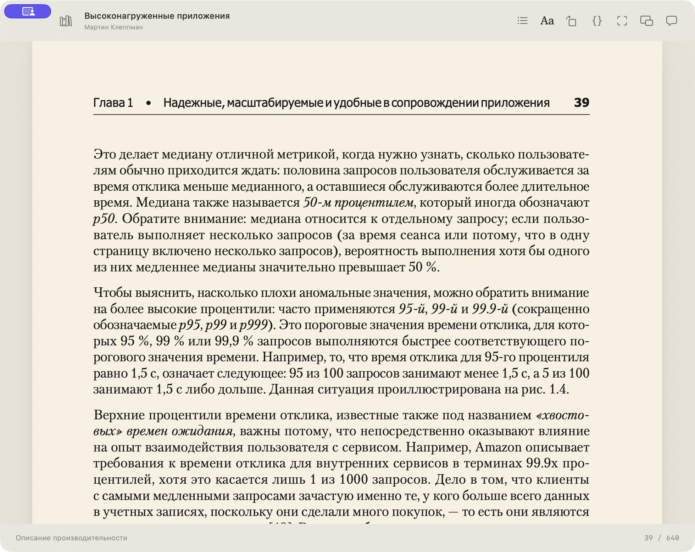
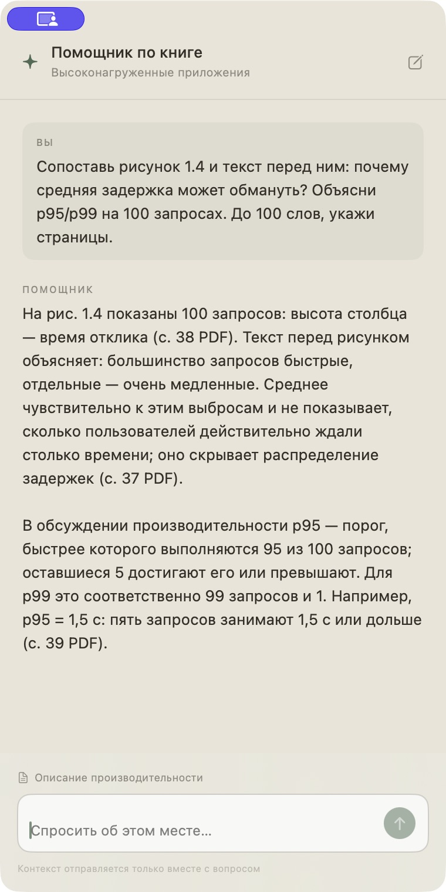
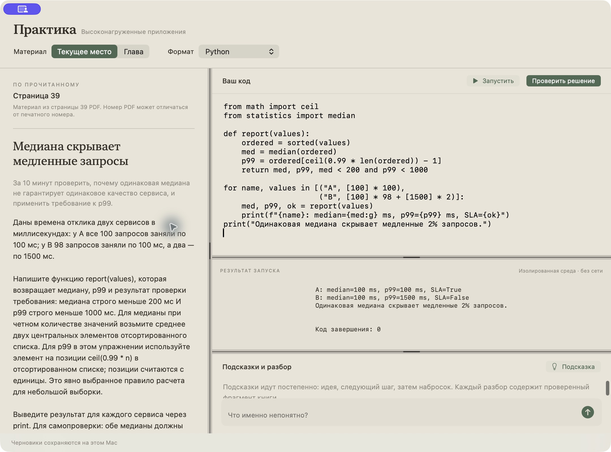
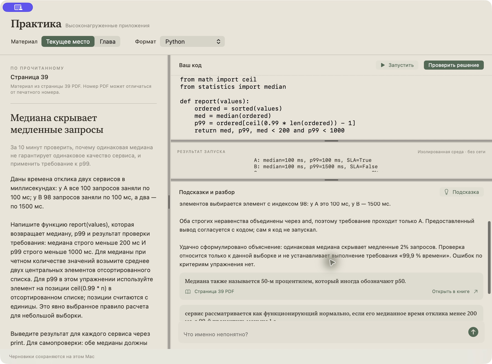
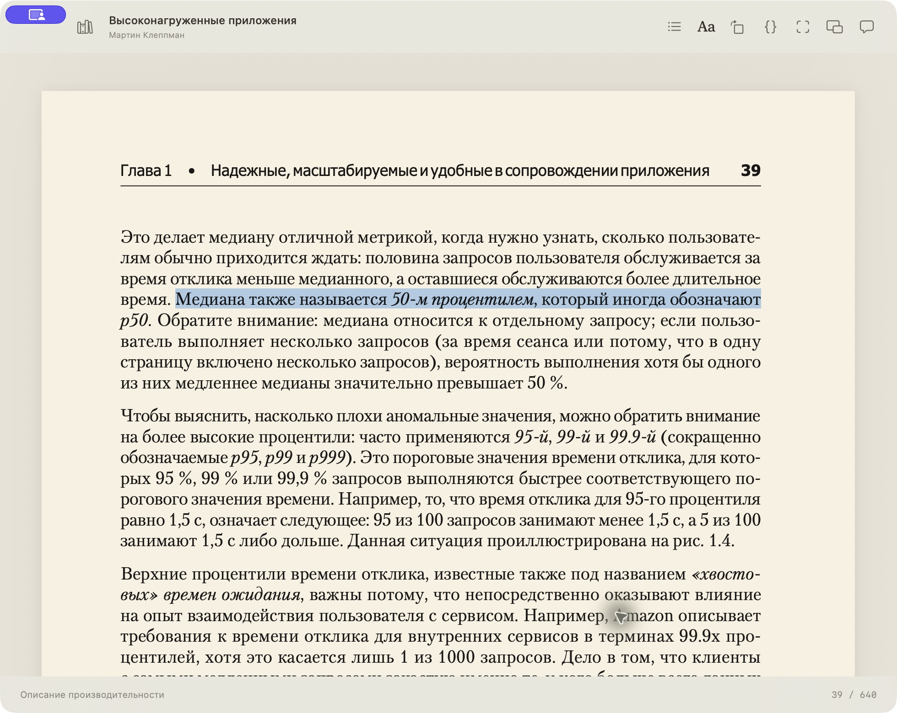
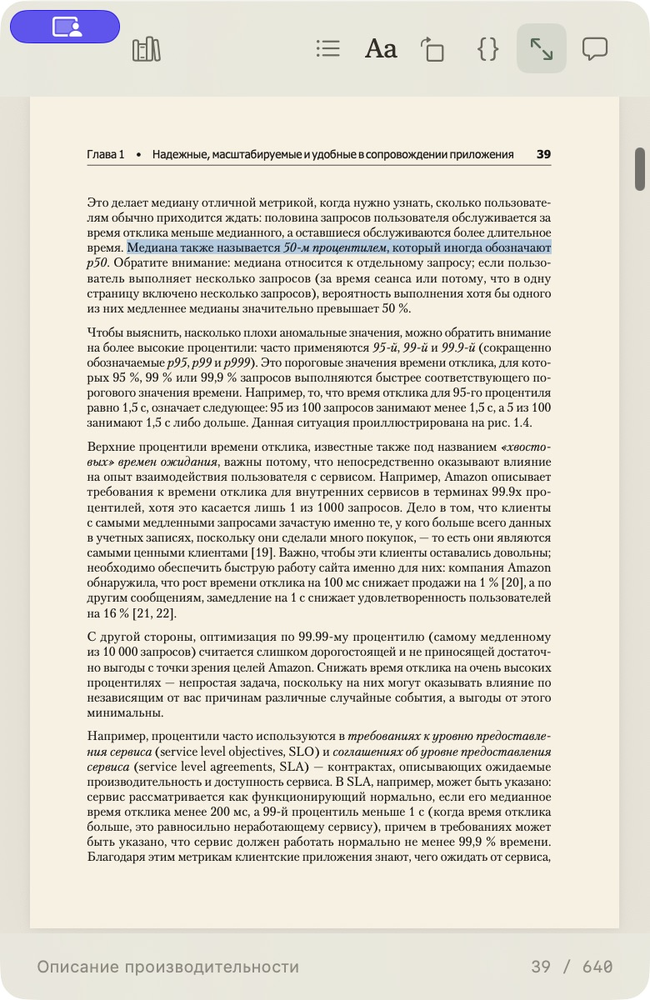

# Лист — читалка для инженеров

Техническая книга, помощник по тексту и практика в одном приложении для macOS.

Вы читаете про задержки, репликацию или границы сервисов. Возникает вопрос — приходится копировать текст в чат, объяснять контекст и потом искать потерянное место в книге. А после понятного ответа всё ещё неясно, сможете ли вы применить идею самостоятельно.

«Лист» связывает эти действия: **прочитать → задать вопрос → решить задачу → вернуться к источнику**.



*Бумажный режим, понятные границы страниц и сохранение места чтения. Чат и практика открываются по запросу.*

## Разобраться в прочитанном

Помощник получает название книги, автора, текущую главу, страницу и выделение. Можно спросить «Почему здесь p95 полезнее среднего?» без ручной подготовки контекста.

Он начинает с текущей страницы. Если для ответа этого мало, ищет **по текущей главе**, затем **по книге до вашего места чтения**. Вся текущая глава может включать страницы впереди; поиск по книге ограничен текущей позицией. Найденные фрагменты дополняют запрос, а не отправляют всю библиотеку целиком.



*Пример на «Высоконагруженных приложениях» Мартина Клеппмана: помощник сопоставляет рисунок и текст, объясняет p95/p99 на 100 запросах и указывает страницы 37–39 PDF.*

## Проверить понимание действием

Откройте практику по текущему месту или главе. ИИ предложит задачу, критерии решения и опору в книге. Напишите код, запустите его, попросите постепенную подсказку или разбор решения. Размеры редактора, вывода и панели подсказок меняются перетягиванием границ.



*Задание «Медиана скрывает медленные запросы»: у двух сервисов медиана 100 мс, но p99 равен 100 и 1500 мс. Python-код показывает, что второй сервис не проходит заданное требование к задержке.*

Для запуска доступны Python, JavaScript и SQLite. Для архитектурных задач можно выбрать текстовое решение.

Подсказки привязаны к фрагментам книги: можно открыть источник и проверить объяснение. Выполнение кода и оценка ИИ — разные действия: результат запуска виден отдельно от разбора.

<details>
<summary>Разбор, переход к источнику, настройка и компактное окно</summary>



*ИИ проверяет выбранный способ расчёта p99 и строгие неравенства из условия. Разбор содержит проверенные фрагменты страницы 39 PDF.*



*Кнопка «Открыть в книге» возвращает к странице 39 и выделяет фрагмент, на который ссылается разбор.*


*Вход через официальный Codex CLI. В репозитории нет аккаунта автора, ключей или готовой авторизации.*



*Компактное окно можно держать поверх других приложений и быстро скрывать горячей клавишей. Значок в строке меню не добавляется.*

</details>

## Начать

Проверенная платформа — **Mac с Apple Silicon**. Приложению нужна **macOS 14+**; для сборки используйте Command Line Tools со Swift 6.2 или новее. Сборка для Intel предусмотрена скриптом, но пока не проверена. Версий для Windows и Linux нет.

```sh
git clone https://github.com/kadessovb02/reader_for_engineers.git
cd reader_for_engineers
./scripts/install.sh
open "$HOME/Applications/Лист — Reader for Engineers.app"
```

Скрипт сам собирает приложение. Если инструменты разработчика ещё не установлены, выполните `xcode-select --install`. Для сборки без установки используйте `./build.sh`. Подробности и решение частых проблем — в [инструкции по настройке](docs/SETUP.md).

1. Добавьте свою книгу через **⌘O**. Поддерживаются PDF, EPUB, FB2, TXT, Markdown, HTML, RTF и DOCX без DRM. Коммерческие книги в комплект не входят.
2. Для помощника установите [официальный Codex CLI](https://learn.chatgpt.com/docs/codex/cli), если его ещё нет: `npm install -g @openai/codex@latest` (нужен Node.js с npm).
3. Откройте настройки **⌘,** и нажмите **«Войти через ChatGPT»**. Завершите вход в браузере своим аккаунтом. Доступность Codex и лимиты определяются вашим аккаунтом; [официальная инструкция по авторизации](https://learn.chatgpt.com/docs/auth).
4. Откройте чат **⌘J** или практику **⌘⇧P**. Для запуска и проверки решений Python, JavaScript и SQLite нужен работающий [Docker Desktop](https://docs.docker.com/desktop/setup/install/mac-install/). Читать, задавать вопросы и разбирать текстовые решения можно без Docker.

## Во время чтения

| Действие | Клавиши |
| --- | --- |
| Показать / скрыть приложение | ⌃⌥Пробел |
| Добавить книгу | ⌘O |
| Библиотека | ⌘L |
| Помощник по книге | ⌘J |
| Практика | ⌘⇧P |
| Компактное окно | ⌘⇧M |
| Режим фокуса | ⌘⇧F |
| Полный экран | ⌃⌘F |
| Открыть поворот схемы в PDF | ⌘⇧R |
| Предыдущая / следующая страница PDF | ← / → |
| Прокрутить вверх / вниз | ↑ / ↓ |

В библиотеке меню **⋯** позволяет менять порядок книг, архивировать и удалять их. Удаление перемещает импортированную копию в Корзину; исходный файл остаётся на месте. При закрытии окна приложение скрывается, **⌘Q** завершает его.

## Что хранится и куда отправляется

Книги, прогресс, переписка и решения хранятся локально. При вопросе или запросе на практику выбранный контекст передаётся через Codex в сервис OpenAI. Авторизацией и её учётными данными управляет официальный CLI. Подробнее: [данные и приватность](docs/PRIVACY.md).

Для запуска упражнений приложение готовит Docker-образ, затем выполняет код в отдельном контейнере без сети, с ограничениями памяти и времени. Это среда для небольших учебных задач: внешние пакеты, полноценные проекты и доступ к файлам Mac в ней не предусмотрены.

## Текущие ограничения

- Интерфейс на русском. Другие языки книг можно импортировать, качество извлечения текста зависит от файла.
- Для помощника нужен читаемый текстовый слой. Встроенного OCR для сканов PDF нет; определение глав в PDF зависит от оглавления и заголовков.
- ИИ может ошибаться. Сверяйте объяснения с источником, а код — с результатами выполнения и собственными проверками.
- Авторизация требует интернета и совместимой версии Codex CLI. Приложение не предоставляет общий аккаунт и не обходит ограничения сервиса.
- Сейчас доступны локальная библиотека и локальное сохранение. Синхронизации между устройствами нет.

## Разработка

Нативное приложение на Swift, SwiftUI и AppKit. PDF отображается через PDFKit, текстовые форматы — через WebKit. Локальная сборка не требует аккаунта разработчика Apple; `build.sh` подписывает её ad hoc.

[Устройство проекта и проверка изменений](docs/DEVELOPMENT.md) · [Сценарий демонстрации](docs/DEMO.md) · [MIT License](LICENSE)

Исходный код приложения распространяется под MIT. Скриншоты сняты в работающем приложении на отдельной демонстрационной библиотеке. В репозитории нет PDF показанной книги, личной библиотеки, переписки, черновиков или токенов пользователя. Пример использует «Высоконагруженные приложения» Мартина Клеппмана; текст книги принадлежит соответствующим правообладателям и не распространяется под лицензией MIT проекта.

---

**English:** List is a native macOS reader for studying technical books. Ask questions with page and chapter context, solve small exercises, and verify hints against source passages. Bring your own books and authenticate with your own ChatGPT account through the official Codex CLI. Apple Silicon, macOS 14+. See [setup](docs/SETUP.md).
