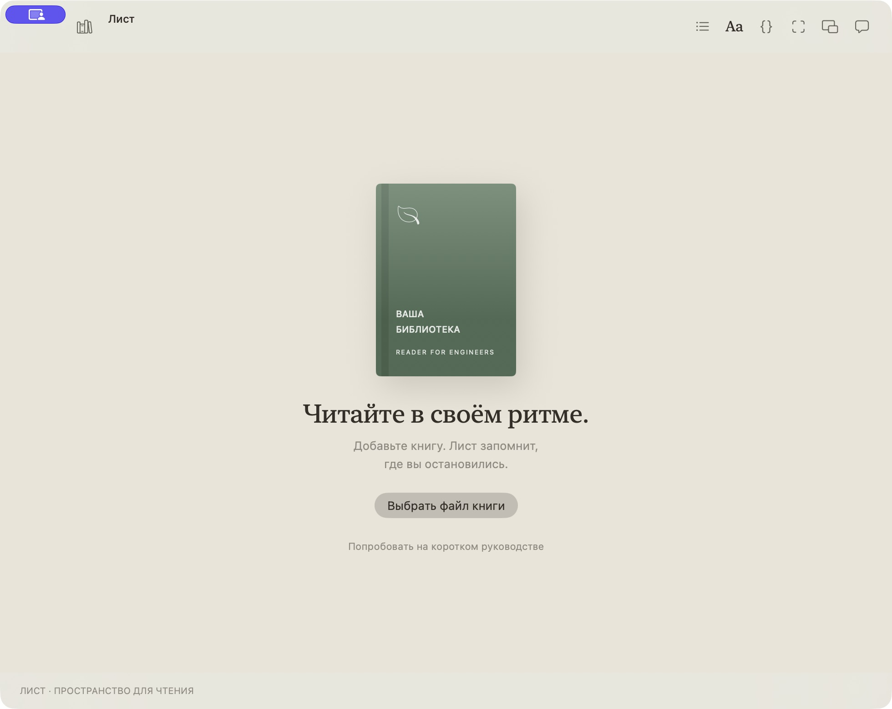
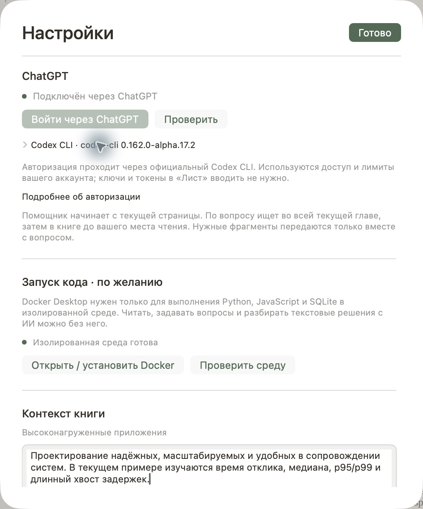

# Установка и первый запуск

Для чтения достаточно собрать приложение и добавить свой файл. Помощник и выполнение кода подключаются отдельно.

## 1. Собрать приложение

Проверенная платформа — **Apple Silicon**; приложение требует **macOS 14+**. Для сборки используйте Command Line Tools со Swift 6.2 или новее. Скрипт также умеет собирать для Intel, но этот вариант пока не проверен. На чистом Mac установите инструменты Apple:

```sh
xcode-select --install
```

Затем:

```sh
git clone https://github.com/kadessovb02/reader_for_engineers.git
cd reader_for_engineers
./scripts/setup.sh --open
```

Этот вариант проверяет локальные зависимости, собирает приложение в `dist` и открывает его. Он не устанавливает Codex, не выполняет вход и не копирует книги с другого компьютера.

Для установки в свою папку приложений:

```sh
./scripts/install.sh
open "$HOME/Applications/Лист — Reader for Engineers.app"
```

Можно собрать напрямую через `./build.sh`; результат тот же. Права администратора для сборки и установки в `~/Applications` не нужны. Подпись локальная, ad hoc; это не нотариально заверенная сборка из App Store.

## 2. Добавить свою книгу

На первом запуске нет чужой библиотеки и коммерческих книг. Нажмите **«Выбрать файл книги»** или **⌘O**, выберите свой файл. Также можно открыть короткое оригинальное руководство и проверить чтение без своей книги.



Поддерживаются PDF, EPUB, FB2, TXT, Markdown (`.md`), HTML, RTF и DOCX без DRM. Файл копируется в локальную библиотеку, исходник остаётся на месте. Место чтения сохраняется при переходах и завершении приложения.

Для помощника PDF должен иметь текстовый слой. Быстрая проверка: можно ли выделить и скопировать предложение из страницы. Если в PDF только изображения, сначала выполните OCR внешним инструментом.

## 3. Подключить свой ChatGPT

«Лист» использует [официальный Codex CLI](https://learn.chatgpt.com/docs/codex/cli). Учётных данных автора в приложении нет. Доступность Codex и лимиты зависят от вашего аккаунта; актуальные способы входа описаны в [официальной документации](https://learn.chatgpt.com/docs/auth).

Если Codex ещё не установлен, установите Node.js с npm, затем выполните:

```sh
npm install -g @openai/codex@latest
```

Откройте **Лист → Настройки…** (**⌘,**), раздел **ChatGPT**:

1. Нажмите **«Войти через ChatGPT»**.
2. Завершите вход в открывшемся браузере своим аккаунтом.
3. Вернитесь в приложение и нажмите **«Проверить»**. Должен появиться статус подключения.

CLI сам хранит учётные данные. «Лист» не просит вставлять токен или пароль. Если вы уже вошли через `codex login`, повторная авторизация обычно не требуется.



Если хотите выполнить подготовку CLI из терминала вместе со сборкой:

```sh
./scripts/setup.sh --with-ai --open
```

Параметр `--with-ai` явно разрешает скрипту установить отсутствующий Codex через npm и запустить его браузерный вход. Нужны интернет и npm; уже установленный CLI автоматически не заменяется.

### Codex не найден или несовместим

- В настройках есть команда установки и кнопка **«Копировать»**, а также ссылка на официальную инструкцию.
- Раскройте строку **Codex CLI**. Нажмите **«Выбрать файл codex…»**, если CLI находится в нестандартном месте, либо **«Автопоиск»** для возврата к обычному поиску.
- Приложение проверяет нужные возможности CLI. Если версия несовместима, обновите её командой `npm install -g @openai/codex@latest` и повторите проверку.
- Если Codex использует API-ключ, выполните вход через ChatGPT. Текущая интеграция рассчитана на этот способ авторизации.

Диагностика из терминала:

```sh
./scripts/doctor.sh
codex --version
codex login status
```

`doctor.sh` ничего не устанавливает и не выполняет вход. Не публикуйте содержимое файлов авторизации при отправке отчёта об ошибке.

## 4. Попробовать вопрос по книге

Откройте содержательную страницу и нажмите **⌘J**. Например:

> Объясни этот фрагмент на примере небольшого сервиса. Что я должен уметь применить после чтения?

Вопрос передаётся вместе с текущим текстом и метаданными книги. При необходимости помощник запросит локальный поиск сначала по текущей главе, затем по книге до текущего места. Описание в разделе **«Контекст книги»** можно дополнить своей целью обучения.

Текущая глава может включать ещё не прочитанные страницы. Вопросы вида «перескажи главу» используют найденные выдержки с ограниченным объёмом контекста, поэтому не гарантируют исчерпывающий пересказ каждого абзаца.

## 5. Включить выполнение упражнений — по желанию

Для чтения, чата, создания заданий, подсказок и разбора текстовых решений Docker не нужен. В упражнениях Python, JavaScript и SQLite он нужен для **«Запустить»** и **«Проверить решение»**: перед разбором ИИ приложение выполняет код и передаёт фактический результат.

1. Установите [Docker Desktop для Mac](https://docs.docker.com/desktop/setup/install/mac-install/) и запустите его.
2. В настройках «Листа» откройте **«Запуск кода · по желанию»** и нажмите **«Проверить среду»**.
3. Откройте практику **⌘⇧P**, выберите формат, создайте задачу и нажмите **«Запустить»** после ввода кода.

При первом запуске языка приложение скачает соответствующий образ Python или Node.js. После подготовки упражнения выполняются без сети. SQLite запускается через Python. Контейнер не получает папки вашего Mac; ограничения — 10 секунд, 256 МБ памяти и один CPU. Доступны стандартные библиотеки выбранной среды. Установка пакетов и доступ к внешним сервисам в учебном контейнере не предусмотрены.

## Частые вопросы

**Книга на месте, но ИИ не отвечает.** Чтение работает локально; для ИИ отдельно нужны интернет, успешный вход и доступный лимит аккаунта. Проверьте статус в настройках.

**Не получается определить главу PDF.** Разметка PDF бывает неполной. Помощник использует оглавление и заголовки; практика при ненадёжных границах может ограничиться текущей страницей. Это отражается в описании выбранного материала.

**Код не запускается.** Убедитесь, что запущен Docker Desktop, среда подготовлена и вы выбрали исполняемый формат. Для текстового формата доступен разбор ИИ, выполнения кода нет.

**Куда пропала программа после закрытия окна?** Закрытие скрывает окно. Верните его через **⌃⌥Пробел** или Dock. **⌘Q** завершает приложение.

**Где лежат данные и как сделать резервную копию?** См. [описание локального хранения](PRIVACY.md). Приложение из этого репозитория использует собственную папку данных и не подключает библиотеку автора.
